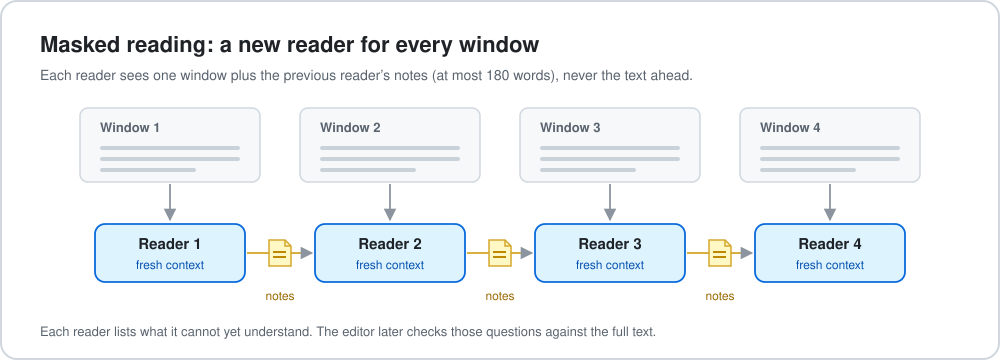
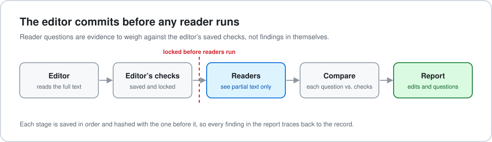
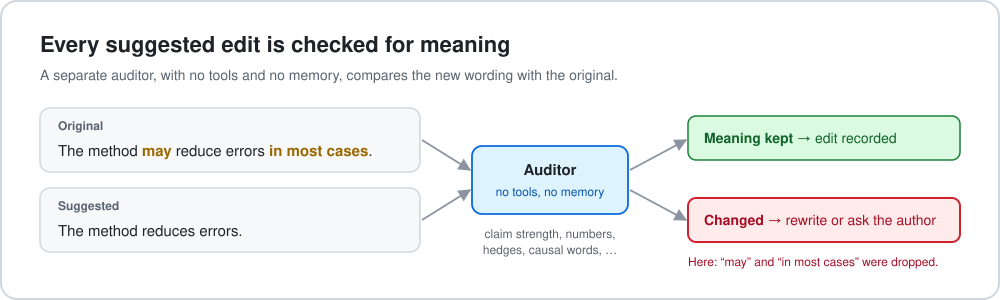

# review-academic-writing

An agent skill that reviews academic manuscripts and research proposals the way a first-time reader meets them, and proposes edits that keep the science intact. It runs in Claude Code, Claude Desktop (Code tab), and OpenAI Codex.

The skill looks for what makes a paper hard to follow: concepts used before they are explained, links between paragraphs left for the reader to supply, claims stronger or weaker than their evidence, and jargon where a plain word would do. It returns findings anchored to exact quotes, replacement wording you can paste in, and questions for the author where the text alone cannot settle the matter.

## How it works

### 1. Readers that cannot look ahead



An editor who has read the whole paper cannot tell where a newcomer gets lost. So besides the full-text editor, the skill sends parts of the manuscript to fresh model readers with no memory and no tools. A *masked reader* sees one window at a time and carries forward only its own short notes; each note records which passages it rests on, and a note that is dropped must give a reason. A *prefix reader* sees the text up to one chosen sentence and nothing after it. *Recall checks* ask questions the reader must answer from its notes alone.

### 2. The editor commits first



The editor's own checks are saved before any reader runs. Reader questions are then sorted against those checks, so they count as evidence to weigh, not as findings. The work is saved in seven stages, in order, each hashed together with the one before it, and a script verifies that every finding in the final report traces back to a recorded candidate, decision, and repair.

### 3. Every edit is checked for meaning



Each proposed wording goes to a separate auditor that compares it with the original on ten properties, including claim strength, quantifiers, numbers, causal language, and every hedge such as "may" or "suggest". This matters because language models tend to turn "may" into "is" when they rewrite ([Isch et al., 2026](https://www.nature.com/articles/s41562-026-02553-x); [arXiv:2606.07951](https://arxiv.org/abs/2606.07951)). An edit that changes any property is not recorded.

Throughout, the review prefers common words and ordinary sentences, and flags coined terms, stacked nouns, and acronyms that do no work.

## What you get

A report in the language you ask for (quotations and suggested wording stay in the manuscript's language), containing:

- the few findings that matter most, each with its location, the reader's question, and a concrete fix;
- replacement wording for each fix the text can support, with a note on what the meaning check found;
- questions for the author where a fix depends on a scientific decision;
- a concept table showing where each key term is first mentioned, first explained, and first relied on;
- a words-and-sentences table with original and suggested phrasing;
- what was verified, how, and what remains uncertain.

## Install

You need Claude Code (or Claude Desktop's Code tab) or OpenAI Codex, signed in to your subscription. The editor, readers, and auditor all run on that subscription; no separate API account is needed.

**Easiest: ask Claude Code to do it.** Paste this into a Claude Code session:

> Install the plugin at https://github.com/infinitywings/review-academic-writing (`claude plugin install review-academic-writing --marketplace https://github.com/infinitywings/review-academic-writing`). Then run its `scripts/setup_mineru.sh`, found under `~/.claude/plugins/cache/infinitywings/review-academic-writing/<version>/skills/review-academic-writing/scripts/`, to install the local MinerU PDF parser and wait until its parse server is ready. Do not use MinerU's `--remote` option. Remind me to restart when you are done.

**Claude Code, by hand.** Inside a session:

```
/plugin marketplace add infinitywings/review-academic-writing
/plugin install review-academic-writing@infinitywings
```

Restart afterwards. To upgrade, run `claude plugin marketplace update infinitywings`, then `claude plugin update review-academic-writing@infinitywings`, and restart.

**Codex.** Clone this repository and open Codex inside it; the skill is available as `$review-academic-writing` through the `.agents/skills/` link. To use it anywhere, copy or link `skills/review-academic-writing/` to `~/.agents/skills/review-academic-writing`.

**PDF manuscripts.** PDFs are parsed locally with [MinerU](https://github.com/opendatalab/MinerU) (about 850 MB of layout, formula, table, and OCR models; not a language model). With [`uv`](https://docs.astral.sh/uv/) installed, one idempotent script installs it, downloads the models, and starts the parse server:

```bash
bash skills/review-academic-writing/scripts/setup_mineru.sh          # install and start
bash skills/review-academic-writing/scripts/setup_mineru.sh --check  # report only, change nothing
```

Without MinerU the skill can fall back to plain-text extraction (`--fallback pdftotext`), which may lose two-column order, formulas, and tables; it marks such runs as low fidelity. Unpublished manuscripts are never sent to MinerU's cloud service. Word and Markdown manuscripts need no parser.

## Run a review

Give the host the manuscript (drag in the PDF or give its path) and say who the reader is, for example:

> Review the writing of this paper with review-academic-writing. The reader is a reviewer in this field who has not seen the project.

The model works through seven stages: extract and index the text; fix the reader profile and scope; take notes on every included passage; check concepts, claims, paragraphs, and wording; dispatch the independent readers; reconcile, decide, and repair, with every wording audited; then check readiness and write the report. All intermediate files go in a run folder next to the manuscript, never inside the skill.

Readers and auditors default to `claude -p --model claude-opus-5-5` with tools, MCP servers, and settings disabled. Add `--runtime codex` to use a Codex subscription, or `--runtime http` for an OpenAI-compatible endpoint on a server. A full review of a 23–30 page manuscript has taken two to three and a half hours and about 70 to 150 reader calls, roughly 5 to 18 USD of equivalent usage. Ask for a quick review, or name a section, to scale it down.

## Limits

- Model readers are not people. Their questions predict where readers may struggle; they do not measure human comprehension.
- The scripts check files, order, coverage, and quotations. They cannot show that a diagnosis is right or that a revision reads better.
- Readers are isolated by what each request contains, not by an operating-system sandbox.
- A plan for validating the method with human readers is in [`validation/`](validation/); it has not been run yet.

## Status

Experimental (version 0.19.1). In October 2026 the full procedure was run on three unpublished manuscripts:

| | Paper A | Paper B | Proposal |
| --- | --- | --- | --- |
| Pages | 28 | 30 | 23 |
| Prefix readers | 8 | 10 | 11 |
| Masked-reading windows | 29 | 72 | 49 |
| Fidelity audits (rejected) | 45 (20) | 37 (16) | 29 (14) |
| Items in the final report | 40 | 65 | 52 |

Typical reasons for rejecting a wording were an added quantifier, a dropped condition, a number carried over from another table cell, or planned work restated in the present tense. The same proposal was also reviewed with the same skill under Codex: the two runs shared only six findings, because one host's readers flagged first-read obstacles while the other's flagged claim strength and logic. Since version 0.17 the checks stage requires both kinds of check for every passage. These are observations from single runs, not a validation.

## Repository layout

| Path | Contents |
| --- | --- |
| `skills/review-academic-writing/` | The skill: `SKILL.md`, `references/` (stage protocol, masked-reading protocol, review rubric, wording rules, output contract, evidence), `assets/` (reader profiles, note templates, prompts), `scripts/`, `server/`, `tests/`, `CHANGELOG.md` |
| `.claude-plugin/` | Plugin and marketplace manifests (marketplace `infinitywings`) |
| `.agents/skills/` | Codex discovery link to the skill folder |
| `docs/` | Design notes, literature review, and server deployment notes (in Chinese) |
| `validation/` | Validation protocol, human-study design, and scoring guide (partly in Chinese) |
| `REFERENCES.md` | Sources the design borrows from, and what each does and does not support |

The full command reference for each script is in [`skills/review-academic-writing/README.md`](skills/review-academic-writing/README.md) (in Chinese) and in `references/`.

## Development

Try local changes with `claude --plugin-dir .` from the repository root and check the manifests with `claude plugin validate .`. Run the tests from the skill folder:

```bash
cd skills/review-academic-writing
python3 -I -m unittest discover -s tests
```

Expect 268 tests to pass (one is skipped when spaCy is not installed). The tests never call MinerU or a real model.

## References

The research behind the design, with the limits of each source, is listed in [`REFERENCES.md`](REFERENCES.md) and [`references/evidence-and-tools.md`](skills/review-academic-writing/references/evidence-and-tools.md).

## License

Apache License 2.0; see [LICENSE](LICENSE). External tools the skill calls, such as MinerU and Claude Code, have their own licenses.

## Author

Chenglong Fu. Developed with Claude Code.
